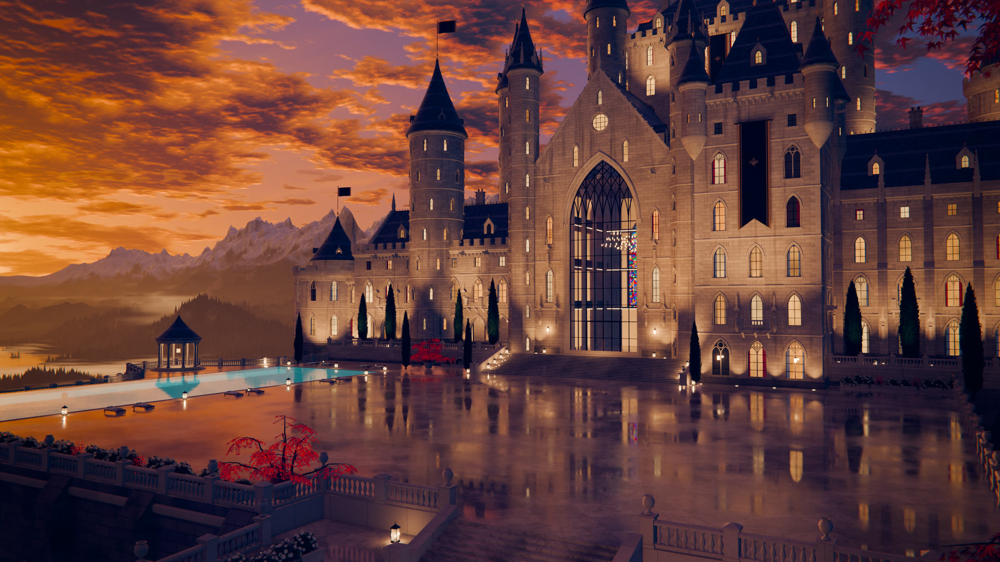
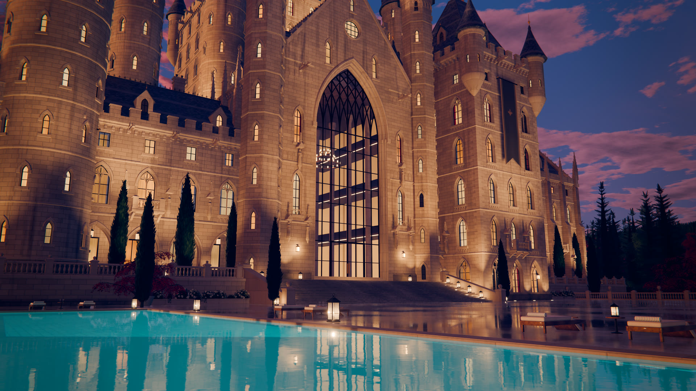
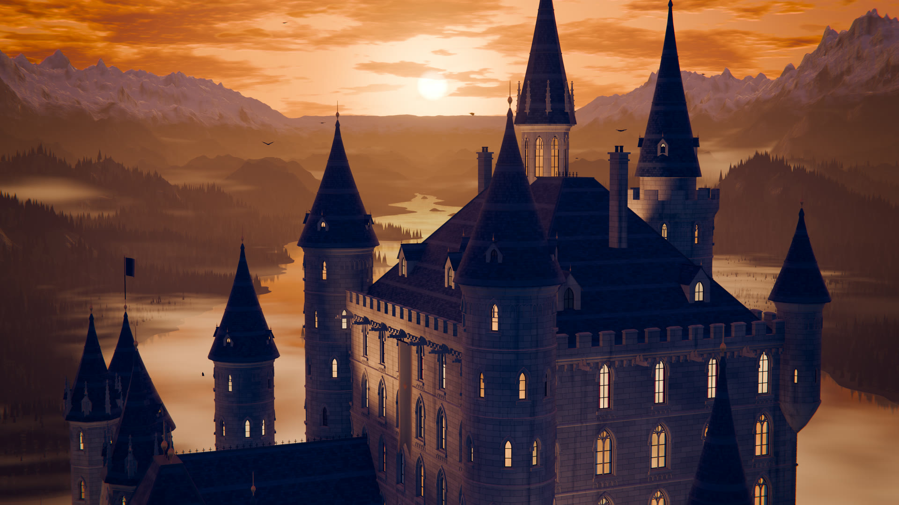
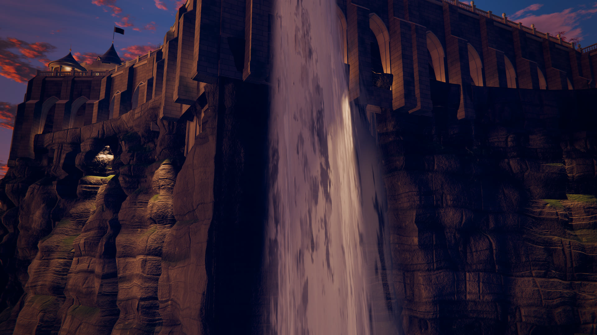
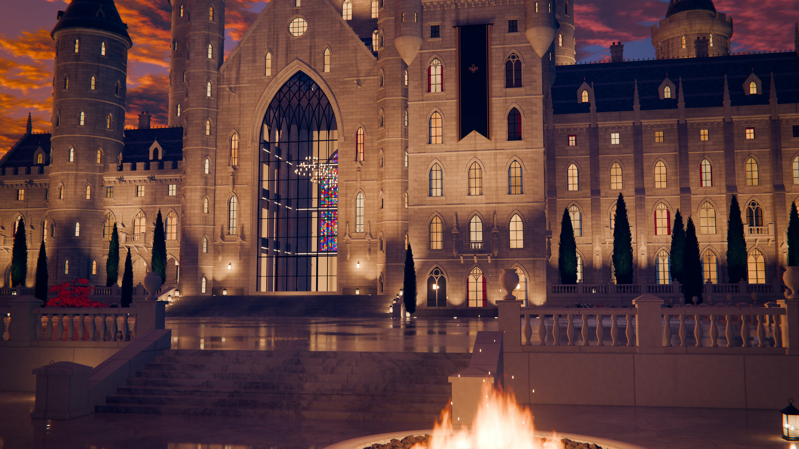
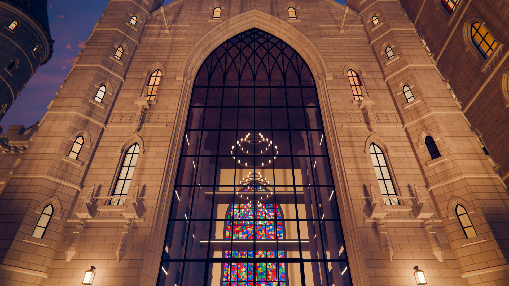

# castle-cinematic

A 45 second 4K film of a gothic castle on a cliff at sunset. Every pixel comes from Python code that builds the
scene in Blender: no downloaded models, no texture files, no image assets.



| | | |
|---|---|---|
|  |  |  |
|  |  | |

## How it was made

One prompt plus reference images went to Claude Fable 5.2 in Claude Code, with the instruction to work on its own
and not ask questions. The prompt and the four short follow-up messages are in [PROMPT.md](PROMPT.md).

- Fable 5.2 wrote the framework, the castle, the terraces, the cameras, the grading and the render pipeline.
- Sub-agents built the rest in parallel: landscape, sky and vegetation (Fable 5.2), water, fire and props (Opus 5.5).
  One more Opus 5.5 agent searched the web for free music and sound effects.
- The scene is about 9.5 million triangles and 78 procedural materials, lit by one sun and 146 small lights,
  generated by about 9,000 lines of Python.
- The film is 1080 frames at 3840x2160, rendered with EEVEE on a laptop with an integrated Radeon 780M
  (Ryzen 7 260). A frame takes 16 to 20 seconds, so the whole film takes about 5.5 hours.
- Wall-clock: started at 2am, the laptop slept from about 4am to 10:30am, final video at about 10pm.

Nothing here is hand-modelled. If a tower looks wrong, the fix is a number in a Python file.

## What is in the scene

| Module (`scene/mods/`) | What it builds |
|---|---|
| `castle.py` + `scene/gothic.py` | great hall with the glazed gothic window, wings, keep, 10 towers, tracery, buttresses, statues, gargoyles, banners, flags, floodlights |
| `terrace.py` | wet marble terraces, infinity pool basin, stairs, balustrades, arcaded retaining walls, lookout pavilion |
| `landscape*.py` | 46 km of terrain, snow mountains, the 300 m cliff, lake, valley mist, distant forest |
| `sky.py` | procedural sunset sky with two drifting cloud layers (one world shader) |
| `vegetation*.py` | red maples with real leaf geometry, cypresses, flower planters, about 23,000 forest trees |
| `water.py` | pool water, overflow films, the waterfall |
| `props.py` | lanterns, sunbeds, sofas, fire pit with animated fire |
| `birds.py`, `cameras.py`, `comp.py`, `perf.py` | birds, the 7 shots, bloom/grain/vignette, render-time settings |

## Build it yourself

Needs Windows, [Blender 5.2](https://www.blender.org/download/), PowerShell 7 and ffmpeg on the PATH.
`tools/bl.ps1` expects Blender at `C:\Program Files\Blender Foundation\Blender 5.2\blender.exe`; change the path
there if yours differs.

```powershell
# 1. build the scene (about 1 minute) and save it
pwsh -NoProfile -File tools\bl.ps1 build.py --mods all --save out/scene.blend --quality final

# 2. look at a shot before committing to the full render
pwsh -NoProfile -File tools\bl.ps1 build.py --mods all --cam s7_hero --at 0.5 --res 1920x1080 --samples 16 --out out/previews/test

# 3. render all 1080 frames (resumable: finished frames are skipped, create out\STOP to stop)
pwsh -NoProfile -File tools\render_all.ps1 1 1080 120 12 3840x2160 out/frames

# 4. soundtrack: download the free audio, then mix it
pwsh -NoProfile -File tools\fetch_audio.ps1
pwsh -NoProfile -File tools\mix_audio.ps1

# 5. encode: 4K master + 1080p version in out\final
pwsh -NoProfile -File tools\make_video.ps1 out\frames castle_cinematic 15
```

`tools/bl.ps1` runs Blender at most twice in parallel and refuses to start when free RAM is under 7 GB, so a
laptop survives the render.

## Audio

The picture is code. The sound is not: the prompt asked for free, professionally made music and effects.

- Music: **'Aphelion' by Scott Buckley**, released under CC-BY 4.0, www.scottbuckley.com.au. If you publish a
  video with it, you have to credit it like this.
- Sound effects: Mixkit (Mixkit Sound Effects Free License) and Freesound (CC0).
- Sources and licence quotes for every file: [assets/audio/CREDITS.md](assets/audio/CREDITS.md). The audio files
  are not in this repo because Mixkit does not allow redistributing them; `tools/fetch_audio.ps1` downloads them.

## Notes

- The reference images from the prompt are not in the repo because they are not ours to license.
- `docs/AGENT_BRIEF.md` is the brief the sub-agents got, `docs/STATUS.md` is the working log, and
  `docs/blender52_api_notes.txt` lists the Blender 5.2 API details that differ from older versions.
- Two things the render settings are built around on this GPU: frame time depends on geometry and shadow maps far
  more than on resolution (4K at 12 samples costs about the same as 1080p at 24), and letting the far landscape
  cast sun shadows made a frame 3 times slower for no visible gain (`scene/mods/perf.py`).

## License

Code: MIT, see [LICENSE](LICENSE). Music and sound effects keep their own licences (see Audio).
